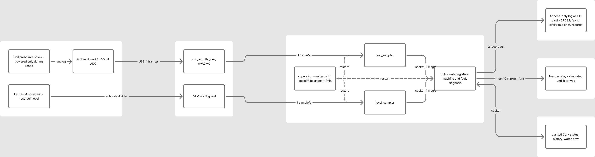

# DESIGN.md — Fault Aware Self Watering Plant System

**Team:** Samuel Berman · Jim Guadagnoli
**Milestone:** M2 design document · **Version:** 0.1 (2026-10-28)
**Repo:** SB-Colostate/CS370-plant-watering · **Builds on:** `PROBLEM.md` (M1). §10 lists what changed since the memo.

> Items marked **[TEAM]** are open decisions we still have to agree on before submitting.

---

## 0. Summary

The users are us (see `PROBLEM.md`): Sam, with potted plants at home in Florida and frequent travel, and Jim, with potted plants in Fort Collins and stretches away from home. A timer waters whether or not the plant needs it, and it can't tell when it has failed. Our device waters **only when the soil needs it**, then **verifies every watering with both sensors**: a **soil probe** (did the soil get wetter?) and an **ultrasonic reservoir gauge** (did water actually leave the tank?). Level dropped but soil stayed dry means a leak. The pump ran but the level didn't drop means the pump or line failed. An empty tank means the pump never runs dry. No single threshold can make these calls; they take both sensors, compared over time.

---

## 1. Architecture

*Figure 1: processes, kernel components, and data rates. Editable source: FigJam board "CS370 Plant Watering - System Architecture".*

**Rates on every arrow**

| Path | Rate | Notes |
|---|---|---|
| Soil → Uno → `/dev/ttyACM0` | 1 frame/s (~12 B) | Uno averages 8 ADC reads |
| HC-SR04 → `level_sampler` | 1 sample/s (5 pings) | median of 5 |
| samplers → hub (Unix socket) | 1 msg/s each | struct with seq + monotonic timestamp |
| hub → storage | ~2 records/s, fsync every 10 s or 50 records | see §4 |
| hub → pump relay | event-driven; ≤ 1 watering/hour; **hard cap 10 min per run** | see §3 |
| supervisor heartbeat → log | 1/min (soak spec requires ≥ 1/hr) | liveness, RSS, counts |

**Wiring for M3:** the HC-SR04 moves from the Uno (where it was for the M2 bring-up) to Pi GPIO23/24, with the echo going through a 1 kΩ/2 kΩ divider, so ranging is timed on the Pi. The Uno remains only as the soil ADC (§10).

---

## 2. Mechanism mapping

We implement **D** and **E** from the Section 3.2 menu. A stretch goal is **C**.

### D — Custom storage layer: crash-consistent append-only log
- **Component:** `src/store/`. Fixed-size binary records `{magic, seq, mono_ns, wall_s, sensor_id, value, flags, crc32}` appended to daily segment files.
- **Why the user needs it:** after a power blip on an unattended SD card, the system must still know **when it last watered**. Otherwise it may water twice, and overwatering kills plants faster than drought. Decisions also depend on history (drying rate, the last result).
- **Crash story:** on startup, the first record with a bad magic or CRC marks a torn write; the log is truncated there. A watering **intent** record is fsynced *before* the relay switches on; an intent with no completion record forces a lockout instead of a second watering.
- **Measured by:** batching vs. fsync cost; recovery after power pulls mid-write (§6).

### E — Multi-process architecture with a supervisor
- **Component:** `src/supervisor/`, `src/sampler_soil/`, `src/sampler_level/`, `src/hub/`. Samplers send data to the hub over Unix domain datagram sockets.
- **Why the user needs it:** the likely failures are hardware: the USB-serial link resets, a probe gets knocked out, a jumper works loose. A hung serial read must not freeze the pump logic. One process per sensor means a dead sensor costs only its own data: the hub marks it STALE and **stops watering** instead of guessing. Restarts back off exponentially (1 s → 60 s) so an unplugged sensor can't cause a restart storm.
- **Measured by:** `kill -9` and unplug trials: detection latency, recovery time, samples lost (§6).

*Stretch:* **C** (`SCHED_FIFO` for ultrasonic echo timing, compared against the default scheduler under load) only if measurements show the median filter doesn't already absorb the jitter.

---

## 3. Analysis engine (our own logic, no models)

The hub runs a **watering state machine**:

`IDLE → NEEDS_WATER → WATERING → VERIFYING → IDLE`, with `FAULT_*` and `LOCKOUT` side states.

- **Needs water:** smoothed soil (EWMA) in the dry band for ≥ N minutes, with hysteresis.
- **Pre-check:** reservoir above minimum, or `FAULT_RESERVOIR_EMPTY` (the pump never runs dry).
- **Watering:** fixed dose, recording level before and after. The pump also stops early if the reservoir hits its minimum mid-run.
- **Hard 10-minute pump cap (safety):** no single run may exceed **10 min**, whatever the state machine asks for. It's enforced twice: (1) the hub arms a `timerfd` deadline when the relay goes ON and forces it OFF at expiry; (2) the **supervisor** independently tracks the pump-on time from the hub's intent message and, if the deadline passes, kills the hub and drives the relay OFF itself. A hung or crashed hub therefore can't leave the pump running. Hitting the cap logs `FAULT_PUMP_TIMEOUT` and enters lockout.
- **Verification (the fusion step):**

| Reservoir level change | Soil change within T minutes | Diagnosis |
|---|---|---|
| dropped ≈ expected | rose | ✅ normal watering |
| no change | no change | `FAULT_PUMP` (dead pump, relay, or clogged line) |
| dropped | no change | `FAULT_LEAK` (tube off, water went elsewhere) or probe out of soil |
| no change | rose | `FAULT_SENSOR_LEVEL` (gauge not tracking) |
| dropped | rose, then falls unusually fast | `CHANNELING` (water runs down the pot wall in dry, hydrophobic mix): log it and switch to smaller split doses |

Outside the verification window, carried over from the M1 memo: soil that **stays wet** for a long time suppresses watering (overwatering / root-rot risk), and a soil reading **flat-lined or pinned at a rail** is a sensor fault, so the system fails safe with the pump OFF.

- **Lockout:** ≤ 1 watering/hour and a daily volume cap, so one bad sensor can't empty the tank onto the floor.
- **Drying rate:** slope between waterings, used to predict the next watering and flag sudden changes.

Thresholds are tuned on episodes we **provoke on purpose**: dry pot, tube pulled from the pot, inlet lifted from the tank, probe pulled from the soil.

---

## 4. Storage and data

| What | Rate | Format | Retention |
|---|---|---|---|
| Soil samples | 1/s | 32-byte binary record | 30 days of raw data, then hourly rollups (min/mean/max) kept for the project |
| Level samples | 1/s | 32-byte binary record | same |
| Watering events (intent / complete / diagnosis) | ≤ 24/day | same record type, `flags` = event | kept forever (tiny) |
| Supervisor heartbeat | 1/min | text line in `plant.log` | rotated at 10 MB, 5 files |

- **Volume:** 2 rec/s × 32 B × 86,400 s ≈ **5.5 MB/day**, ~170 MB per 30 days.
- **Write policy:** `fsync()` every **10 s or 50 records**; watering intents are fsynced **immediately**. Batching limits SD wear; the per-event fsync protects the one record whose loss could cause harm.
- **Power dies mid-write:** we lose ≤ 10 s of samples (soil changes over hours). Torn tails fail the CRC check and are truncated; an unfinished watering forces a lockout.

---

## 5. Constraints and substitutions

| Ideal | What we're using | What the gap costs us |
|---|---|---|
| Pi 5 (memo) | **Pi 3** | Budget. Slower builds; ample headroom for 2 Hz sensors. |
| ADS1115 / MCP3008 ADC (memo) | **Uno as USB ADC** until an ADC is ordered | Extra device and a serial link that can fail on its own, which we treat as a real failure mode the supervisor must handle. |
| Capacitive soil probe (memo) | **Kit resistive probe** | It corrodes, so it's powered only during reads. Raw ADC counts, not % moisture: we calibrate dry/wet per pot and claim no more. |
| HALJIA float switch (memo) | **HC-SR04** | It's a *gain*, not a downgrade: a level reading instead of one bit (see §10). Cost: needs an echo divider and is noisy < 2 cm, so we use median-of-5 and a tank deep enough to stay in range. |
| Pump installed | **Pump on order** | Until it arrives, the pump is **simulated** (GPIO LED + water moved by hand), labeled as simulated everywhere. |
| Camera, temp/humidity | **Deferred** | Added after the two-sensor pipeline and soak are solid; not graded mechanisms. |
| Months of real cycles | **Provoked episodes + replay** | Ground truth comes from pots we dry and water on purpose; replayed data is labeled as such. |

---

## 6. Evaluation plan

| # | Measurement | Method | Target |
|---|---|---|---|
| 1 | Sample-to-storage latency | Timestamp at sampler (CLOCK_MONOTONIC) vs. at durable write; idle vs. `stress-ng --cpu 4` | p99 < 15 s (bounded by fsync batching); watering intent fsync p99 < 100 ms |
| 2 | Recovery after power cut mid-write | Pull power during writes, 20 trials; run recovery; compare against expected seq | 0 corrupt records accepted; ≤ 10 s of data lost; 0 double-waterings |
| 3 | Child crash recovery (E) | `kill -9` each child, 20 trials each, random times | Detection < 2 s; restart < 5 s; hub stays up 100 % of trials |
| 3b | Pump cap enforcement | `SIGSTOP` the hub mid-watering (cap lowered to 30 s for testing), 10 trials | Relay OFF within cap + 1 s in 10/10 trials |
| 4 | Sensor unplug (E, demo scenario) | Unplug Uno USB / HC-SR04 for 10 min | Fault logged < 5 s; no watering while blind; auto-recovery after replug |
| 5 | Ultrasonic accuracy & jitter | 50 samples at 5 known distances (ruler); stretch: SCHED_FIFO vs. default under load | ±1 cm after median filter |
| 6 | Diagnosis accuracy (domain metric) | ≥ 5 provoked episodes of each case in §3 | Correct diagnosis ≥ 90 %; 0 dry pump runs |
| 7 | Resource footprint | RSS + CPU per process from heartbeats over the 48 h soak | Flat RSS (no growth trend); total CPU < 10 % on the Pi 3 |

---

## 7. Failure-mode table

| Component | Failure | Detection | Response | Log shows |
|---|---|---|---|---|
| Soil probe / Uno | USB unplugged, Uno reset | `read()` error/EOF or no frame for 5 s | sampler exits; supervisor restarts with backoff; hub marks soil STALE → **no watering** | `WARN soil STALE since …`, `INFO soil_sampler restart #n` |
| Soil probe | Probe pulled from soil / reads 0 constantly | value stuck at floor for > X min after a watering | hub flags `FAULT_SENSOR_SOIL`; no watering | `FAULT probe_out_of_soil?` |
| Soil probe | Flat-lined or shorted (disconnected, corroded, or wet electronics) | pinned at 1023, or no change across a watering that drew water from the tank. *Not* a reading of 0 alone: our module reads ≈ 0 when dry, so 0 is a valid value | `FAULT_SENSOR_SOIL`; pump OFF | `FAULT soil_flatline value=…` |
| Serial frames | Garbled line | parse/format check fails | discard line, count it | `bad_frames=n` in heartbeat |
| HC-SR04 | Unplugged / no echo | pulse timeout on all 5 pings | level STALE → watering blocked | `WARN level no_echo` |
| HC-SR04 | Noisy reading | spread of 5 pings > threshold | discard sample | `level_rejects=n` |
| Reservoir | Empty / below min | level reading | `FAULT_RESERVOIR_EMPTY`; pump never runs | `FAULT reservoir_low level=…cm` |
| Pump / tubing | Dead pump, clog | level unchanged after dose | `FAULT_PUMP`; lockout | `FAULT pump_no_flow` |
| Pump / tubing | Leak, tube off pot | level dropped, soil unchanged | `FAULT_LEAK`; lockout | `FAULT leak_suspected` |
| Any child process | Crash / hang | `waitpid` / missed heartbeat on socket | restart with backoff (1 s → 60 s) | `ERROR child=… exit=… restarting in …` |
| Hub | Crash | supervisor `waitpid` | restart; storage recovery runs; pump relay forced OFF at start | `ERROR hub died`, `INFO recovery truncated n bytes` |
| Pump | Stuck ON (hub hung, logic bug) | 10-min deadline: hub `timerfd`, backed by supervisor | relay forced OFF; hub killed if unresponsive; lockout | `FAULT pump_timeout ran=600s → relay OFF` |
| Storage | Torn write after power loss | CRC/magic mismatch on startup scan | truncate to last valid record | `INFO recovered seq=… dropped=…` |
| Storage | Disk filling | free space check each hour | rotate/rollup old segments; refuse new raw data below 5 % free | `WARN disk_free=…%` |
| Whole Pi | Power loss mid-watering | intent record without completion | lockout until a human acknowledges | `WARN unfinished watering found → LOCKOUT` |

---

## 8. Ownership map  **[TEAM — proposed split, confirm with Sam]**

| Area | Owner | Notes |
|---|---|---|
| Hardware, wiring, Uno firmware (`arduino/`) | Jim | in-person; owns all physical integration |
| Samplers: `src/sampler_soil`, `src/sampler_level` | Jim | serial tty + GPIO timing |
| Supervisor (mechanism E): `src/supervisor` | Jim | crash/unplug testing is physical |
| Storage layer (mechanism D): `src/store` | Sam | testable without hardware (replay) |
| Analysis engine / state machine: `src/hub` | Sam | runs against replayed logs |
| CLI `plantctl`, evaluation scripts | Shared | |

The non-owner reviews every diff.

---

## 9. AI-use plan

- **Claude Code is for:** planning (plan mode first), explaining termios/libgpiod/fsync semantics, test fixtures and the replay harness, adversarial diff review, and debugging from **pasted evidence**.
- **Not for:** anything at runtime. The product makes **no network calls**: no LLM APIs, cloud, or pretrained models. Diagnosis logic in `src/hub/` is ours.
- **Visible boundary:** `make check-boundary` greps `src/` for network clients; Python lives only in `tools/` (the bring-up script `plantpi.py` moves there from `pi/`).
- **Hardware rule:** the agent can't see the breadboard (it already misread a floating pin as data; see PROMPTLOG.md), so no hardware conclusion without a measurement.

---

## 10. Changes since the M1 problem memo

The problem, the users, and the mechanisms (**E** and **D**) are unchanged. The hardware changed once we got it on the bench:

| M1 memo said | M2 design | Why |
|---|---|---|
| HALJIA float switch in the reservoir | **HC-SR04 ultrasonic level gauge** | A float switch reports one bit at one height: it can say "empty" but not "did this watering actually draw water." Continuous level lets us split the memo's single *delivery fault* row into **pump/line failure** (level unchanged) vs. **leak or runoff** (level dropped, soil dry), and warn *before* the tank is empty. |
| Capacitive soil sensor | **Resistive probe from the kit** | On hand and verified working at M2. The project runs about a month, so corrosion is managed by powering the probe only during reads. The memo's risk (readings reliable enough to diagnose from) still applies; calibration on the real pot and mix is unchanged. |
| ADS1115 or MCP3008 ADC (to be ordered) | **Arduino Uno as a USB ADC** | The Uno from the kit gave us a working analog path for M2 with no new parts. It sends raw readings only; **all decisions stay on the Pi**. **[TEAM]** confirm with the TA, or switch to an MCP3008 if the Uno isn't allowed. |
| Raspberry Pi 5 | **Raspberry Pi 3** | Budget: the Pi 3 was the more affordable option. The design fits either board, and nothing depends on Pi 5-only features. At 2 Hz of sensor data the Pi 3 has plenty of headroom; the cost is slower on-device builds. |
| Pump and/or solenoid valves | **Pump only** (on order; simulated until it arrives) | One actuator is enough for one pot per device. **[TEAM]** confirm whether Sam's build uses a valve. |
| No run-time limit stated | **Hard 10-minute cap per pump run** | Backs up the memo's rule that a hung process must never leave water running (§3). |

